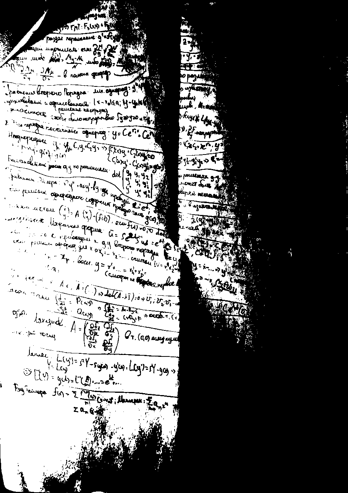
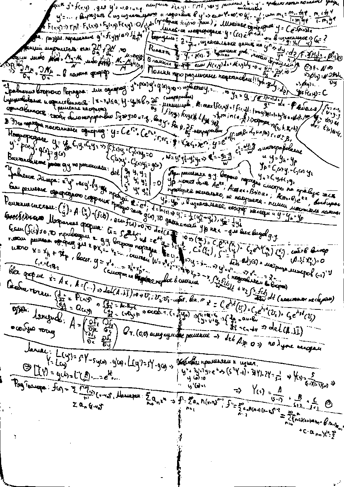
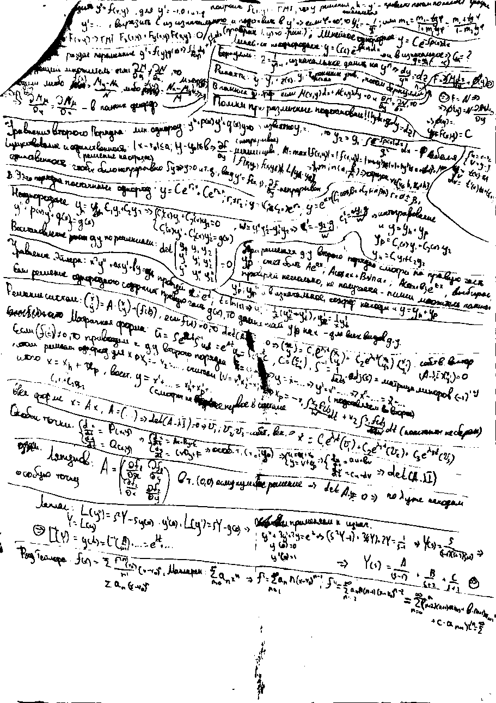
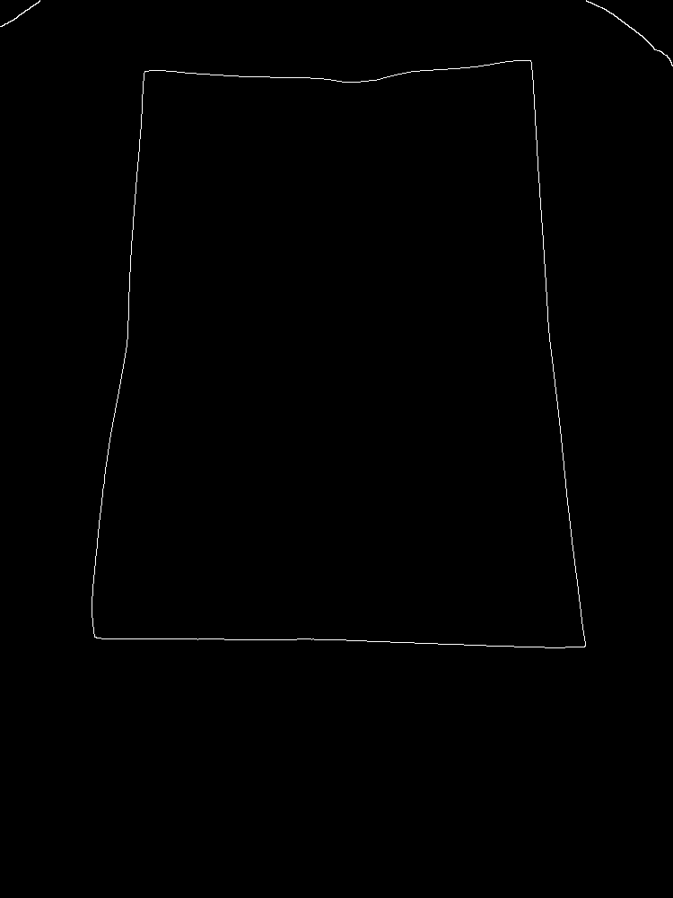
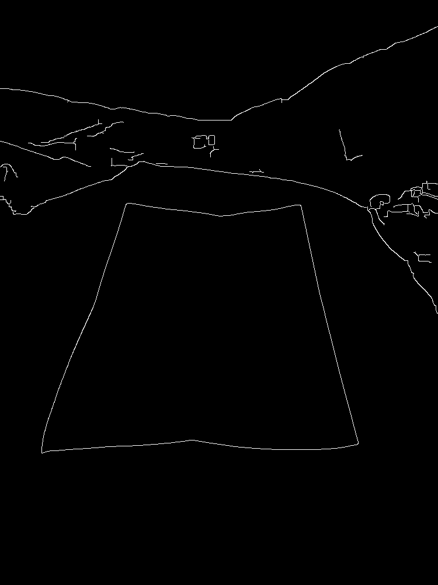
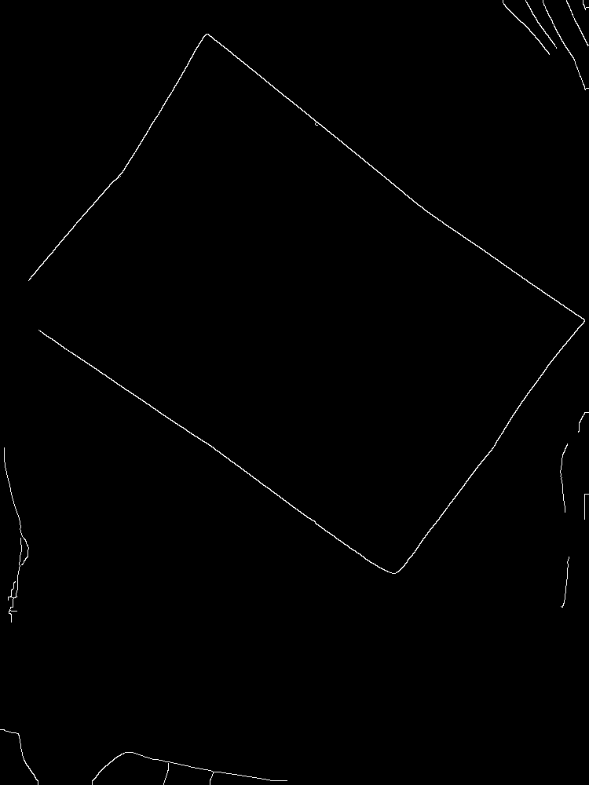
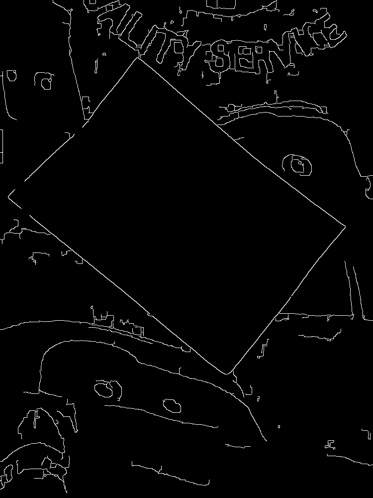
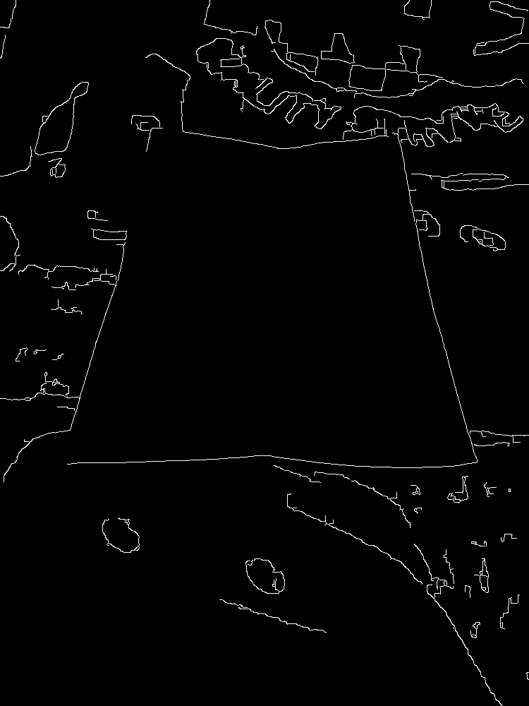
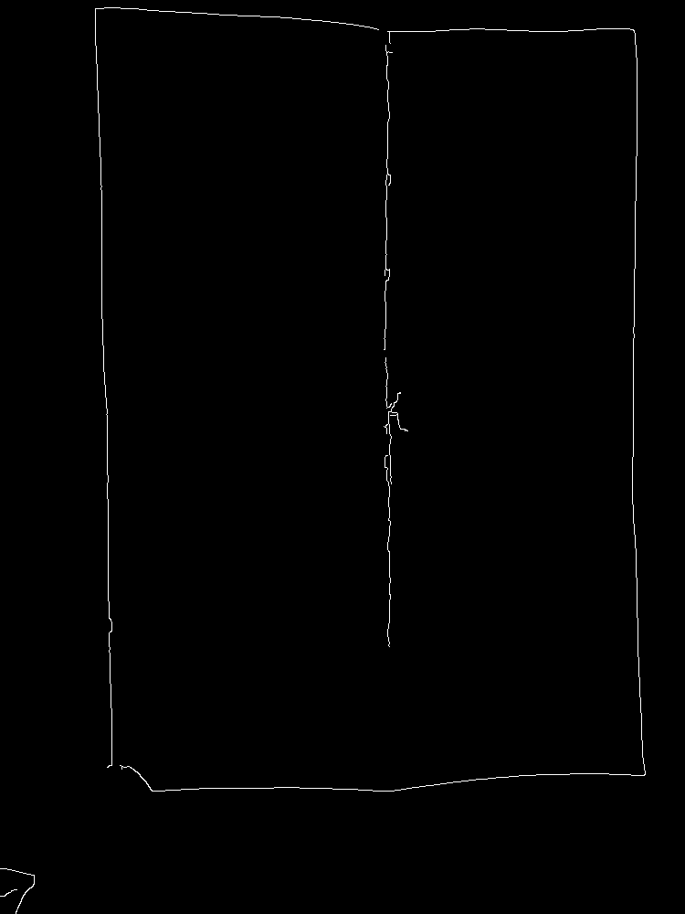
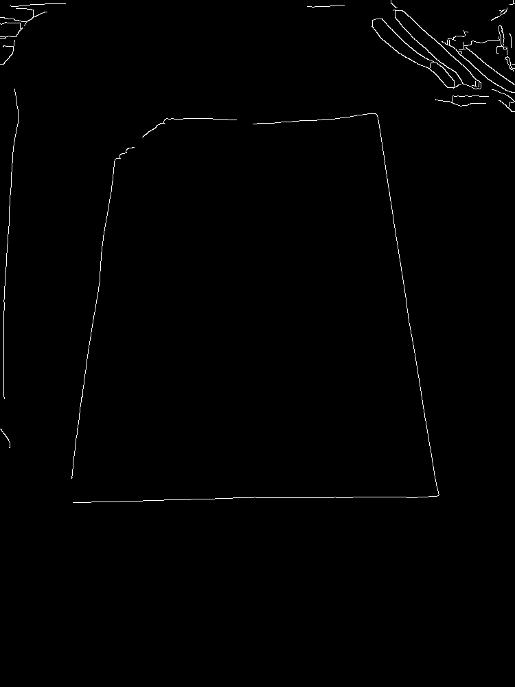

# ДЗ 2 «Сканер документов» - отчёт

**Автор:** Georgiy Kvaratskheliia  
**Группа / трек:** MFAI-02 
**Дата подготовки:** 02.11.2026.

Реализованы 13 функций в `docscan.py`. Основной результат на своих кадрах: `auto` нашёл лист с IoU $\ge$ 0.9 на 11 из 15 положительных кадров, правильно отклонил 1 из 3 негативных. На веб-камере получено 14.1 FPS в режиме `auto`.

## 1. Числа

Источник основной таблицы - [out/eval_1000_seeds20.csv](out/eval_1000_seeds20.csv). Значения шума, краёв, бинаризации и камеры перенесены из консольного вывода моих запусков и сохранены в [out/session_measurements.json](out/session_measurements.json). Этот JSON составлен по выводу терминала. Дополнительные карты краёв и проверка тестов выполнены при подготовке отчёта на OpenCV 4.14.0, NumPy 2.3.5.

### 1.1. Шум

Команды `noise` выполнены с рабочей длинной стороной 640, размер рабочего кадра - 480 × 640.

| Кадр | Освещение | $\sigma$ шума |
|---|---|---:|
| `data/01.jpg` | обычное комнатное | 1.24 |
| `data/10.jpg` | лампа сбоку | 1.24 |
| `data/13.jpg` | приглушённое, лампа вместо основного света | 1.73 |

Проверка на `data/01.jpg`, seed по умолчанию 0:
 
| Добавлено $\sigma$ | Оценка на зашумлённом кадре | $\sigma$ фильтра | Остаток измеренный | Остаток по формуле $\sigma_n\sqrt{\sum h^2}$ |
|---:|---:|---:|---:|---:|
| 5 | 5.68 | 1.60 | 0.88 | 0.88 |
| 10 | 10.38 | 2.93 | 0.97 | 0.96 |
| 25 | 23.23 | 3.00 | 2.38 | 2.35 |

На кадре в полумраке оценка шума составила 1.73 против 1.24 на двух других кадрах. Фильтр выбирает $\sigma_f$ по формуле $\sigma_f=\sigma_n/(2\sqrt{\pi}\,\mathrm{target})$, затем ограничивает её диапазоном [1, 3]. При добавке 25 достигнут верхний предел, поэтому остаток больше целевого 1. Измеренный и предсказанный остатки расходятся не более чем на 0.03. Оценка $\sigma$ на зашумлённом изображении не обязана совпадать с добавкой: в кадре уже есть собственный шум и детали, после добавления применяются ограничения яркости.

### 1.2. Края

Настройки: `--long-side 640`, кроме отдельно отмеченных карт разбора ошибок при 1000. По умолчанию `--close 9`, пороги от медианы.

| Кадр | параметры запуска | Медиана | Canny lo / hi | Краёв, % | Отрезков Хафа |
|---|---|---:|---|---:|---:|
| `01.jpg` | по умолчанию | 148 | 99 / 196 | 0.53 | 15 |
| `01.jpg` | `--close 0` | 134 | 89 / 178 | 0.59 | 16 |
| `01.jpg` | `--canny 50,150` | 148 | 50 / 150 | 0.53 | 15 |
| `07.jpg` | по умолчанию | 156 | 104 / 207 | 0.69 | 16 |
| `07.jpg` | `--close 0` | 149 | 99 / 198 | 1.19 | 21 |

Карты: [01 с закрытием](out/01_edges.png), [01 без закрытия](out/01_edges_close0.png), [01 фиксированные пороги](out/01_edges_fixed.png), [07 с закрытием](out/07_edges.png), [07 без закрытия](out/07_edges_close0.png).

На пёстром фоне `07` закрытие уменьшает долю краёв с 1.19% до 0.69%, число отрезков - с 21 до 16. Вместе с закрытием меняется медиана и автоматические пороги, поэтому разница относится ко всему этапу предобработки. На `01` эффект слабее.

### 1.3. Набор: IoU и время

Все фотографии собственные, один лист с рукописным текстом. Разметка: [data/corners.json](data/corners.json). Для перекрытых и загнутых углов отмечено предполагаемое положение исходного угла. Все 18 файлов имеют длинную сторону $\le$ 2000 и размер $\le$ 1 МБ.

**Ограничение набора:** все фотографии сняты при искусственном освещении. Требование трёх дневных кадров не выполнено, поскольку съёмка проводилась вечером. Кадры 13-15 сняты при приглушённом освещении лампой вместо основного света. Наклоны 30°/60° приблизительные, инструментально не измерялись. Квоты фонов выполнены: 01-03 - тёмный, 04-06 - светлый, 07-09 - пёстрый. 05 и 08 - поворот около 45 градусов; 10-12 - боковая лампа и частично перекрытая граница.

Выбранная настройка: `--canny 50,150 --close 9 --long-side 1000 --seed 0`. В `hough_ok_of_20` проверены зёрна 0-19. На положительных кадрах успех - IoU $\ge$ 0.9; на негативных - отказ, поэтому число успехов не означает число найденных объектов.

| Кадр | Что на нём | Contour IoU | Hough IoU | Hough: успехов / 20 | Auto IoU (путь) | мс: contour / hough / auto |
|---|---|---:|---:|---:|---|---|
| 01.jpg | тёмный фон, почти сверху | 0.994 | 0.941 | 13 | 0.994 (contour) | 41.2 / 62.9 / 16.6 |
| 02.jpg | тёмный фон, умеренный наклон | 0.993 | 0.0 | 1 | 0.993 (contour) | 14.4 / 33.5 / 12.9 |
| 03.jpg | тёмный фон, сильный наклон | 0.986 | 0.878 | 0 | 0.986 (contour) | 13.4 / 38.2 / 12.4 |
| 04.jpg | светлый фон, почти сверху | 0.99 | 0.939 | 20 | 0.99 (contour) | 12.2 / 36.0 / 12.0 |
| 05.jpg | светлый фон, поворот около 45° | 0.0 | 0.95 | 20 | 0.95 (hough) | 9.3 / 36.1 / 36.9 |
| 06.jpg | светлый фон, умеренный наклон | 0.0 | 0.917 | 20 | 0.917 (hough) | 10.4 / 36.5 / 37.3 |
| 07.jpg | пёстрый фон, почти сверху | 0.992 | 0.972 | 20 | 0.992 (contour) | 14.1 / 38.8 / 14.1 |
| 08.jpg | пёстрый фон, поворот около 45° | 0.0 | 0.951 | 20 | 0.951 (hough) | 13.0 / 47.4 / 44.4 |
| 09.jpg | пёстрый фон, сильный наклон | 0.0 | 0.0 | 0 | 0.0 (отказ) | 11.6 / 39.5 / 40.0 |
| 10.jpg | боковая лампа, палец на углу | 0.0 | 0.45 | 0 | 0.45 (hough) | 8.3 / 35.5 / 35.8 |
| 11.jpg | боковая лампа, ручка поперёк края | 0.0 | 0.0 | 0 | 0.0 (отказ) | 9.9 / 36.5 / 36.7 |
| 12.jpg | боковая лампа, загнутый угол | 0.0 | 0.978 | 20 | 0.978 (hough) | 9.0 / 39.7 / 37.3 |
| 13.jpg | полумрак, тёмный фон | 0.995 | 0.975 | 20 | 0.995 (contour) | 11.1 / 37.0 / 11.2 |
| 14.jpg | полумрак, светлый фон | 0.0 | 0.0 | 0 | 0.0 (отказ) | 10.3 / 37.1 / 38.1 |
| 15.jpg | полумрак, пёстрый фон | 0.0 | 0.949 | 20 | 0.949 (hough) | 11.3 / 40.2 / 40.6 |
| 16.jpg | негативный: закрытая книга | найден | отказ | 20 | найден (contour) | 12.6 / 37.8 / 13.0 |
| 17.jpg | негативный: два угла вне кадра | отказ | отказ | 20 | отказ (отказ) | 10.4 / 37.0 / 38.1 |
| 18.jpg | негативный: мятый лист | найден | найден | 1 | найден (contour) | 12.2 / 36.2 / 12.2 |

Сводка в ячейках далее: **успехов на положительных; средний IoU по всем положительным, включая отказы; негативных отклонено; среднее время, мс**. Значения сводок восстановлены из CSV; возможна разница 0.001 из-за округления IoU в строках.

| Настройка и источник | Contour | Hough | Auto |
|---|---|---|---|
| Автопороги, close 9, 640 ([CSV](out/eval_default640.csv)) | 4/15; 0.265; 1/3; 7.7 | 5/15; 0.492; 2/3; 30.4 | 7/15; 0.569; 1/3; 20.7 |
| 50,150, close 9, 640 ([CSV](out/eval_fixed640.csv)) | 5/15; 0.331; 1/3; 7.0 | 9/15; 0.634; 2/3; 30.5 | 10/15; 0.649; 1/3; 20.7 |
| 30,90, close 9, 640 - мой компьютер ([CSV](out/eval_30_90.csv)) | 7/15; 0.506; 1/3; 7.9 | 4/15; 0.304; 2/3; 35.4 | 7/15; 0.556; 1/3; 18.1 |
| 50,150, close 5, 640 - мой компьютер ([CSV](out/eval_close5.csv)) | 5/15; 0.331; 1/3; 7.6 | 7/15; 0.503; 2/3; 32.8 | 9/15; 0.639; 1/3; 22.0 |
| Автопороги, close 0, 640 ([CSV](out/eval_close0.csv)) | 4/15; 0.265; 1/3; 8.5 | 5/15; 0.323; 2/3; 37.8 | 8/15; 0.523; 1/3; 22.9 |
| 50,150, close 9, 1000 ([CSV](out/eval_1000.csv)) | 6/15; 0.397; 1/3; 14.8 | 9/15; 0.660; 2/3; 39.2 | 11/15; 0.743; 1/3; 27.7 |

Устойчивость выбранной настройки: 8 положительных кадров имеют 20/20 успехов Хафа, `01` - 13/20, `02` - 1/20; `03`, `09`, `10`, `11`, `14` - 0/20. `Auto` на `02` и `03` выручает путь контуров. Все пять положительных кадров, где при выбранной настройке `auto` использует Хаф и проходит порог (`05`, `06`, `08`, `12`, `15`), имеют 20/20 успехов Хафа.

**Сверка на кадрах курса.** Источники: [sample_data/README.md](sample_data/README.md), [автопороги](out/sample_eval.csv), [50,150](out/sample_eval_50_150.csv). При автопорогах: contour 2/4, hough 3/4, auto 3/4, средний IoU auto 0.742. С 50,150: contour 3/4, hough 3/4, auto 4/4, средний IoU auto 0.989. Негативный `nosheet.jpg` отклонён всеми методами. Это совпадает со сводкой курса; на `plain.jpg` автопороги [127,254] дали 0% краёв, а 50/150 вернули лист с IoU 0.989. На `tiles.jpg` при фиксированных порогах Хаф отказал, но контуры нашли лист. Время обработки зависит от компьютера, результаты RANSAC могут измениться при смене random seed.

### 1.4. Бинаризация

`block=31`, `C=15`. Для своего кадра сначала выполнено выпрямление `12.jpg` с выбранными настройками, затем три метода применены к одному `out/12_scan.jpg`.

| Кадр и метрика | Otsu | Adaptive | Flat |
|---|---:|---:|---:|
| `text-lamp.png` курса: совпадение с `text-gt.png`, % | 56.8 | 98.8 | 99.9 |
| `12.jpg` с тенью: чёрных пикселей, % | 58.65 | 13.83 | 13.32 |

Полученные значения совпадают с указанными в `sample_data/README.md`. Для своего кадра указана доля чёрных пикселей, поскольку эталонной бинарной маски нет. Otsu использует один глобальный порог и принимает тёмную половину страницы за чернила. Adaptive и flat устраняют большую часть тени и сохраняют различимый текст, но оставляют артефакты сгиба. У flat артефакт в нижней части сгиба визуально меньше. Утверждать абсолютное превосходство по сохранности всех штрихов без эталона нельзя.

| Otsu | Adaptive | Flat |
|---|---|---|
|  |  |  |

Кадр курса: [Otsu](out/course_binary_otsu.png), [Adaptive](out/course_binary_adaptive.png), [Flat](out/course_binary_flat.png). Исходные `text-lamp.png` и `text-gt.png` берутся из `../../lectures/L03-color-histograms/demo` репозитория курса и не входят в этот архив.

### 1.5. Видео

Процессор: **12th Gen Intel Core i9-12900H**. Камера: **640 × 480**, `--source 0`. Настройки всех трёх запусков: `--canny 50,150 --close 9 --long-side 1000 --seconds 10`. Параметр long-side не увеличивает исходный кадр камеры сверх его размера.

| Режим | Кадров | Длительность измерения, с | FPS | Обнаружений, % | Детекция, медиана, мс |
|---|---:|---:|---:|---:|---:|
| contour | 285 | 10.01 | 28.5 | 0.0 | 10.3 |
| hough | 285 | 10.03 | 28.4 | 15.4 | 26.2 |
| auto | 141 | 10.00 | 14.1 | 59.6 | 48.0 |

Ролики: [auto](out/video.mp4), [contour](out/video_contour.mp4), [hough](out/video_hough.mp4). Размер каждого меньше 10 МБ. Требование auto $\ge$ 10 FPS выполнено. Это три отдельных живых записи: движения и положение листа не были одинаковыми. Поэтому по долям обнаружений нельзя строго ранжировать методы. Доля обнаружений не проверяет правильность рамки: ручной покадровой разметки видео нет.

FPS рассчитан по числу обработанных кадров и реальному времени работы программы; длительность воспроизведения MP4 отличается из-за фиксированной частоты записи 20 кадров/с.

## 2. Три вопроса

### 2.1. Где выигрывают контуры и Хаф + RANSAC?

На `02` и `03` в выбранной настройке контуры дают IoU 0.993 и 0.986; Хаф при seed 0 даёт отказ и IoU 0.878. Контуры используют весь контур и допускают небольшие локальные разрывы после закрытия. В последовательном RANSAC ошибка выбора или уточнения одной из четырёх прямых портит итоговые пересечения. Даже хорошая доля точек на длинной стороне не гарантирует восстановления оставшихся сторон.

| Контуры: `02` | Контуры: `03` |
|---|---|
|  |  |

На `05` и `08` контуры не находят допустимый четырёхугольник, а Хаф даёт IoU 0.950 и 0.951 и 20/20 успехов. На картах видны длинные части сторон, хотя контур после сглаживания и закрытия не прошёл отбор как четырёхугольник. RANSAC может использовать эти части без требования единой замкнутой цепочки. На `08` дополнительно есть линии рисунка фона; найденные длинные стороны всё же дают правильные пересечения.

| Хаф: `05` | Хаф: `08` |
|---|---|
|  |  |

Оба пути не проходят IoU $\ge$ 0.9 на `09`, `10`, `11`, `14`. На `09` видны посторонние линии пёстрого фона и слабая верхняя граница; на `10` палец разрывает край, а сгиб и тень создают сильную внутреннюю линию. На `14` светлый фон и складки дают разрывы границы.

| Отказ: `09` | Ошибка: `10` | Отказ: `14` |
|---|---|---|
|  |  |  |

### 2.2. Что показало правило медианы Canny?

При 640, close 9 и seed 0 автопороги сработали в режиме auto на 7 из 15 кадров; фиксированные 50/150 - на 10 из 15. Автопороги не проходят на `04`, `05`, `06`, `08`, `09`, `10`, `14`, `15`. Медиана описывает яркость всего кадра, а не величину перепада на границе листа. Поэтому на светлом фоне пороги могут оказаться выше слабого перепада, а на пёстром фоне пороги пропускают много посторонних линий. В нарисованном `plain.jpg` курса это особенно явно: автопороги не оставили краёв.

Снижение до 30/90 увеличило число успехов контуров до 7/15, но Хаф получил 4/15; вместе auto дал 7/15. Значит, снижение порогов помогает не всегда: в RANSAC добавляются конкурирующие линии. Оставлены 50/150, close 9 и long-side 1000: auto даёт 11/15 и средний IoU 0.743.

### 2.3. Шум, текст и закрытие

Оценка исходного шума составила 1.24 при обычном комнатном и боковом свете, 1.73 в полумраке. Для этих кадров при 640 выбиралась минимальная $\sigma$ фильтра 1. При синтетической добавке 5, 10, 25 выбраны 1.60, 2.93, 3.00; формула остатка согласуется с измерением до 0.03. Множитель 6 в оценке связан с $\sqrt{\sum h^2}=6$ для используемого ядра, а 0.6745 - с медианой модуля нормальной величины.

Закрытие перед Canny подавляет тёмные штрихи текста. На `07` число отрезков падает 21 $\rightarrow$ 16, доля краёв 1.19% $\rightarrow$ 0.69%. Это уменьшает число конкурирующих гипотез Хафа. Но сильная обработка может ослаблять полезные границы: при автопорогах без закрытия auto нашёл 8/15 вместо 7/15, хотя средний IoU снизился 0.569 $\rightarrow$ 0.523.

## 3. Негативные кадры и отказы

На `16` (книга) контуры и auto дают ложное срабатывание: светлая прямоугольная обложка проходит геометрические проверки и простую проверку яркости. Хаф в выбранной настройке корректно отказывает 20/20 раз. На `17` два угла вне кадра, все три пути корректно отказывают; Хаф - 20/20. На `18` мятый лист по условию размечен как негативный, но его общая форма остаётся близкой к четырёхугольнику: контуры и auto принимают его за документ, Хаф отказывает только 1/20 раз. Программа проверяет форму и яркость, поэтому может принять книгу или мятый лист за документ.

Пример ошибки на положительном кадре - `10`: auto выдаёт IoU 0.450, приняв сгиб/тень за одну из сторон и выделив часть листа. Возможное улучшение - отбирать больше кандидатов прямых и оценивать поддержку всего периметра, не брать первую допустимую четвёрку; дополнительно нужна проверка внутренней линии против внешней границы, в текущем коде не реализовано. Пересъёмка ровного листа на контрастном фоне могла бы облегчить кадр, но сложные снимки сохранены для честной оценки.

## 4. Настройка

Единая настройка для кадров проверяющего:

```text
--canny 50,150 --close 9 --long-side 1000
```

Дефолты функций и интерфейс CLI не изменялись; настройка задаётся параметрами запуска. Для scan - `--binarize flat` по умолчанию, aspect A4 книжный. Альбомную страницу нужно запускать с `--aspect 1.414`, ориентацию текста при необходимости задавать через `--turn`.

## 5. Команды и воспроизводимость

Команды запускаются из корня проекта. Время зависит от компьютера. Для собственной камеры нужны OpenCV с оконной поддержкой и доступ к устройству. Исходные кадры курса лежат в `sample_data/`; файлы бинаризации L3 доступны относительно корня репозитория курса.

```bash
pip install -r requirements.txt
python -m pytest tests -q
python docscan.py annotate data/*.jpg --ann data/corners.json

python docscan.py noise data/01.jpg
python docscan.py noise data/10.jpg
python docscan.py noise data/13.jpg
python docscan.py noise data/01.jpg --add-sigma 5
python docscan.py noise data/01.jpg --add-sigma 10
python docscan.py noise data/01.jpg --add-sigma 25

python docscan.py edges data/01.jpg -o out/01_edges.png
python docscan.py edges data/01.jpg --close 0 -o out/01_edges_close0.png
python docscan.py edges data/01.jpg --canny 50,150 -o out/01_edges_fixed.png
python docscan.py edges data/07.jpg -o out/07_edges.png
python docscan.py edges data/07.jpg --close 0 -o out/07_edges_close0.png

python docscan.py eval data --ann data/corners.json --csv out/eval_default640.csv
python docscan.py eval data --ann data/corners.json --canny 50,150 --csv out/eval_fixed640.csv
python docscan.py eval data --ann data/corners.json --canny 30,90 --csv out/eval_30_90.csv --overlays out/eval_30_90
python docscan.py eval data --ann data/corners.json --canny 50,150 --close 5 --csv out/eval_close5.csv --overlays out/eval_close5
python docscan.py eval data --ann data/corners.json --close 0 --csv out/eval_close0.csv
python docscan.py eval data --ann data/corners.json --canny 50,150 --close 9 --long-side 1000 --csv out/eval_1000.csv --overlays out/eval_1000
python docscan.py eval data --ann data/corners.json --canny 50,150 --close 9 --long-side 1000 --seeds 20 --csv out/eval_1000_seeds20.csv

python docscan.py edges data/02.jpg --canny 50,150 --close 9 --long-side 1000 -o out/02_edges_selected.png
python docscan.py edges data/03.jpg --canny 50,150 --close 9 --long-side 1000 -o out/03_edges_selected.png
python docscan.py edges data/05.jpg --canny 50,150 --close 9 --long-side 1000 -o out/05_edges_selected.png
python docscan.py edges data/08.jpg --canny 50,150 --close 9 --long-side 1000 -o out/08_edges_selected.png
python docscan.py edges data/09.jpg --canny 50,150 --close 9 --long-side 1000 -o out/09_edges_selected.png
python docscan.py edges data/10.jpg --canny 50,150 --close 9 --long-side 1000 -o out/10_edges_selected.png
python docscan.py edges data/14.jpg --canny 50,150 --close 9 --long-side 1000 -o out/14_edges_selected.png

python docscan.py eval sample_data --ann sample_data/corners.json --csv out/sample_eval.csv --overlays out/sample_eval
python docscan.py eval sample_data --ann sample_data/corners.json --canny 50,150 --csv out/sample_eval_50_150.csv --overlays out/sample_eval_50_150
python docscan.py detect sample_data/plain.jpg --canny 50,150 --ann sample_data/corners.json -o out/plain_detect.jpg
python docscan.py scan sample_data/plain.jpg --canny 50,150 -o out/plain_scan.jpg --bw out/plain_bw.png

python docscan.py scan data/12.jpg --canny 50,150 --close 9 --long-side 1000 -o out/12_scan.jpg
python docscan.py binarize out/12_scan.jpg --method all -o out/12_binary.png
python docscan.py binarize ../../lectures/L03-color-histograms/demo/text-lamp.png --gt ../../lectures/L03-color-histograms/demo/text-gt.png --method all -o out/course_binary.png

python docscan.py video --source 0 --method contour --canny 50,150 --close 9 --long-side 1000 --seconds 10 --save out/video_contour.mp4
python docscan.py video --source 0 --method hough --canny 50,150 --close 9 --long-side 1000 --seconds 10 --save out/video_hough.mp4
python docscan.py video --source 0 --method auto --canny 50,150 --close 9 --long-side 1000 --seconds 10 --save out/video.mp4
```

`session_measurements.json` сохранён по терминальному выводу пользователя, `edges_selected.json` содержит команды и JSON дополнительных карт. Таблицы отчёта вычислены из приложенных CSV. Файлы `out/` сохранены из переданного архива; дополнительные источники помечены выше.

## 6. Инструменты и проверка

Использованы шаблон ДЗ и собственные лабораторные: `lab03-color/lab03.ipynb` (`divide_bg`), `lab04-geometry/lab04.ipynb` (`order_by_angle`, `rectify`), `lab07-edge/lab07.ipynb` (`find_document_corners`, `ransac_line`). Из лабораторных сохранена основная логика, внесены изменения под сигнатуры и требования ДЗ: RANSAC с переданным rng и уточнением fit_line; сортировка по углу; размер выхода по четырём сторонам; деление фона во float32. Остальные небольшие функции дописаны по подсказкам шаблона.

[ChatGPT](https://chatgpt.com/) использован для объяснений, проверки фотографий, подбора параметров запуска, обработки результатов, шаблона отчёта. Фото, разметка, измерения камеры, функции, отчёт выполнены мной. Помощник запускал код на переданных фотографиях, проверял структуру и повторно выполнял тесты в качестве проверки фотографий. Исходные учебные материалы - лабораторные 3, 4, 7 и [README кадров курса](sample_data/README.md); ссылки на реализацию: [docscan.py](docscan.py), на проверки - [tests/test_docscan.py](tests/test_docscan.py).
